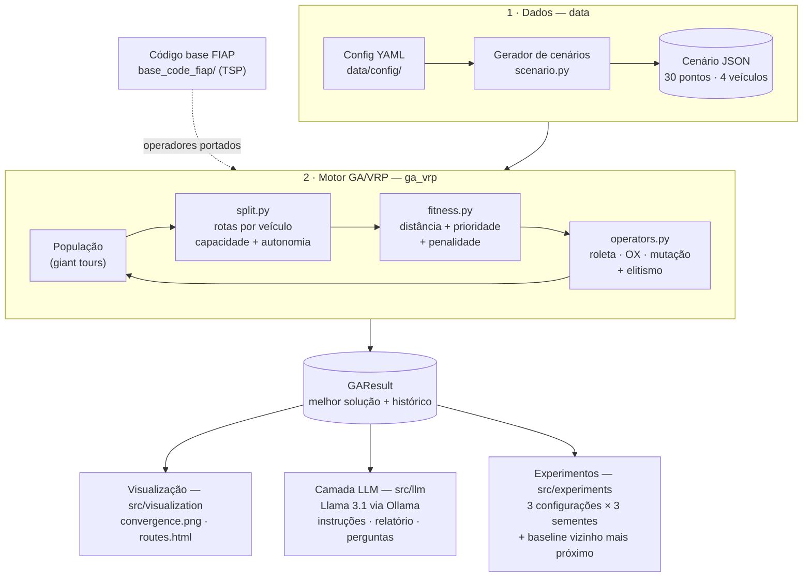

# Tech Challenge – Fase 2: Otimização de Rotas Médicas (VRP + Algoritmo Genético + LLM)

Sistema de otimização de rotas para distribuição de medicamentos e insumos entre unidades
hospitalares, usando um Algoritmo Genético para resolver um VRP (Vehicle Routing Problem) com
restrições realistas, e uma LLM para gerar instruções de entrega, relatórios e responder perguntas
em linguagem natural sobre as rotas. Desenvolvido como parte do Tech Challenge (Fase 2) da Pós-Tech
FIAP.

| Entregável | Onde |
|---|---|
| Relatório técnico (PDF) | [Relatório Técnico Fase 2.pdf](reports/Relatório%20Técnico%20Fase%202.pdf) — fonte em [relatorio_tecnico.md](reports/relatorio_tecnico.md) |
| Vídeo de demonstração | https://vimeo.com/1241054183 |
| Repositório | https://github.com/caiolsantana/techChallenge2 |

### Integrantes

| Aluno | RM |
|---|---|
| Anderson Alves de Oliveira Mares | RM376889 |
| Caio Leandro de Santana | RM377048 |
| Gabrielle Miguel Feitosa | RM376095 |
| Duarte Deivide | RM376838 |

## 1. Sobre o projeto

O hospital enfrenta desafios logísticos na distribuição eficiente de medicamentos e insumos entre
suas unidades e para atendimento domiciliar. Este projeto resolve o problema do "caixeiro viajante
médico" (TSP/VRP) com múltiplos veículos, prioridades de entrega, capacidade de carga e autonomia,
e usa uma LLM para traduzir os resultados em instruções e relatórios acionáveis.

## 2. Código base

Ponto de partida fornecido pela FIAP: https://github.com/FIAP/genetic_algorithm_tsp — uma
implementação simples de Algoritmo Genético para TSP com visualização em Pygame. Uma cópia de
referência (não modificada) está em [base_code_fiap/](base_code_fiap/); o algoritmo evoluído para VRP vive em
`src/ga_vrp/`. Os operadores do código base (população aleatória, Order Crossover, mutação por
troca, seleção por roleta com peso `1/fitness` e elitismo) foram portados para o novo modelo de
domínio; o que transforma o TSP em VRP é o decodificador `split.py`, que divide a permutação em
rotas por veículo respeitando capacidade e autonomia.

## 3. Arquitetura



1. **Dados** — o gerador cria um cenário sintético no formato/escala de São Paulo (depósito na
   Praça da Sé, pontos com prioridade e demanda, frota com capacidade e autonomia).
2. **Motor GA/VRP** — evolui permutações de pontos ("giant tours"); cada uma é decodificada em
   rotas por veículo e avaliada pela função fitness.
3. **Saídas** — a melhor solução alimenta a visualização, a camada LLM e os experimentos
   comparativos com a heurística do vizinho mais próximo.

## 4. Estrutura do repositório

```
techChallenge2/
├── README.md                  # este arquivo
├── requirements.txt           # bibliotecas necessárias
├── .env.example               # variáveis de ambiente da LLM (copiar para .env)
├── reports/
│   ├── Relatório Técnico Fase 2.pdf  # relatório técnico (entrega)
│   └── relatorio_tecnico.md   # relatório técnico (fonte)
├── base_code_fiap/            # código base da FIAP, como referência (não modificado)
├── data/
│   ├── config/                # configuração do gerador de cenários (YAML)
│   └── scenarios/             # cenário versionado usado em todas as execuções
├── docs/                      # avaliação da LLM, experimentos e figuras do relatório (img/)
├── src/
│   ├── ga_vrp/                # modelo de domínio + algoritmo genético para VRP
│   ├── data/                  # geração de cenários sintéticos
│   ├── visualization/         # gráfico de convergência e mapa de rotas
│   ├── llm/                   # integração com a LLM (instruções, relatórios, Q&A)
│   └── experiments/           # 3 configurações do GA × 3 sementes + baseline guloso
├── tests/                     # testes automatizados (pytest, LLM simulada)
└── results/
    ├── experiments.json/.csv  # métricas dos experimentos
    ├── llm-evaluation*.json   # respostas reais da LLM e notas da rubrica
    └── figures/               # gráfico de convergência e mapa interativo
```

## 5. Como executar

### Pré-requisitos
- Python 3.12 (recomendado; funciona a partir do 3.11).
- Para a camada LLM: o [Ollama](https://ollama.com/download) instalado localmente com o modelo
  `llama3.1` (cerca de 5 GB: `ollama pull llama3.1`). Não precisa de chave de API; depois de
  baixado, o modelo roda sem internet.

> **Python 3.14 ou mais novo:** o `pygame==2.6.1` fixado em `requirements.txt` não tem pacote
> pronto para essas versões e a instalação falha. O pygame só é usado pelo `base_code_fiap/` (demo
> original da FIAP); o sistema em `src/` não depende dele. Nesse caso, instale as demais
> dependências sem ele (comando abaixo). Observação: o `base_code_fiap/tsp.py` original também não roda
> com o Matplotlib 3.10+ fixado no projeto (usa `tostring_rgb()`, removido nessa versão); ele é
> mantido apenas como referência.

### Passo a passo — Linux/Mac

```bash
git clone https://github.com/caiolsantana/techChallenge2.git
cd techChallenge2
python3 -m venv venv
source venv/bin/activate
pip install -r requirements.txt
cp .env.example .env        # os valores padrão já usam o Llama 3.1 via Ollama
```

### Passo a passo — Windows (PowerShell)

```powershell
git clone https://github.com/caiolsantana/techChallenge2.git
cd techChallenge2
py -3.12 -m venv venv              # sem o 3.12? instale com: py install 3.12
.\venv\Scripts\Activate.ps1        # se bloquear: Set-ExecutionPolicy -Scope CurrentUser RemoteSigned
pip install -r requirements.txt
# Python 3.14+: pip install @((Get-Content requirements.txt) -notmatch '^pygame')
Copy-Item .env.example .env        # os valores padrão já usam o Llama 3.1 via Ollama
```

No Windows, o comando `python` pode abrir a Microsoft Store em vez do Python; use `py` para criar
o ambiente virtual e, com ele ativado, `python` passa a funcionar normalmente.

### Comandos

Execute na raiz do repositório, com o ambiente virtual ativado:

| Comando | O que faz | Saída |
|---|---|---|
| `python -m pytest -q` | 16 testes automatizados (LLM simulada, sem custo) | `16 passed` |
| `python -m src.ga_vrp.ga` | demo rápida do GA (8 pontos, 2 veículos) | rotas e fitness no terminal |
| `python -m src.data.scenario` | regenera o cenário sintético a partir do YAML | `data/scenarios/sp_default.json` |
| `python -m src.visualization` | roda o GA e gera gráfico + mapa | `results/figures/` |
| `python -m src.experiments` | 3 configurações × 3 sementes + vizinho mais próximo | `results/experiments.*` |
| `python -m src.llm instructions --provider ollama` | instruções de entrega por veículo | texto no terminal |
| `python -m src.llm report --provider ollama` | relatório operacional | texto no terminal |
| `python -m src.llm ask --question "Quais são as entregas críticas e em que ordem serão atendidas?" --provider ollama` | pergunta livre sobre as rotas | texto no terminal |
| `python -m src.llm.evaluate --provider ollama` | coleta as 3 respostas para avaliação manual | `results/llm-evaluation.json` |

> **Use `--provider ollama` nos comandos da LLM**: assim a chamada vai direto para o Llama 3.1
> local, que é o modelo avaliado pelo grupo.

A LLM do projeto é o **Llama 3.1 8B rodando localmente pelo Ollama**. Antes dos comandos
`src.llm`, deixe o Ollama aberto (ele inicia o servidor em `http://localhost:11434`) e confirme
que o modelo indicado em `OLLAMA_MODEL` foi baixado (`ollama pull llama3.1`). O tempo de espera
por resposta é de 600 s e pode ser ajustado em `OLLAMA_TIMEOUT`. A primeira chamada também carrega
o modelo na memória, então convém rodar um comando antes de uma demonstração. A avaliação realizada
com o Llama 3.1 e seus critérios estão em [docs/fase4-avaliacao-llm.md](docs/fase4-avaliacao-llm.md).

Todas as execuções usam o cenário versionado `data/scenarios/sp_default.json` e semente fixa, então
as rotas, o fitness e as distâncias são reproduzíveis. O GA mede e otimiza as distâncias em **unidades de coordenada**
(diferença euclidiana entre latitude/longitude). Nas respostas da LLM, cada distância também
aparece em **quilômetros aproximados em linha reta**, calculados pela fórmula de Haversine trecho a
trecho (depósito → paradas → depósito) e enviados prontos no prompt, para o modelo não fazer a
conversão sozinho. Na solução padrão, as 3,605 unidades equivalem a cerca de 384 km. Esses km
**não são o percurso real pelas ruas**, que é mais longo.

## 6. Resultados principais

Cenário: 30 pontos de entrega (9 críticos), 4 veículos disponíveis.

| Método | Fitness médio (menor é melhor) | Distância média | Violações | Pontos sem rota |
|---|---:|---:|---:|---:|
| Vizinho mais próximo (baseline) | 264,69 | 2,31 | 0 | 0 |
| GA `small_swap` | 51,92 | 4,63 | 0 | 0 |
| GA `medium_swap` | 52,09 | 4,37 | 0 | 0 |
| GA `large_inversion` | 58,72 | 4,90 | 0 | 0 |

O GA reduz o fitness em 78% a 80% na média das configurações (74% a 81% por execução) frente ao
baseline, porque coloca as entregas críticas no início das rotas; o baseline percorre menos
distância, mas atende críticos no meio e no fim das rotas.
A camada LLM, validada com Llama 3.1 local, passou de 9/18 para 18/18 pontos na rubrica de
avaliação após a revisão dos prompts (avaliação feita antes da inclusão dos km no prompt). Análise completa no
[relatório técnico](reports/Relatório%20Técnico%20Fase%202.pdf), em [docs/fase5-experimentos.md](docs/fase5-experimentos.md)
e em [docs/fase4-avaliacao-llm.md](docs/fase4-avaliacao-llm.md).
