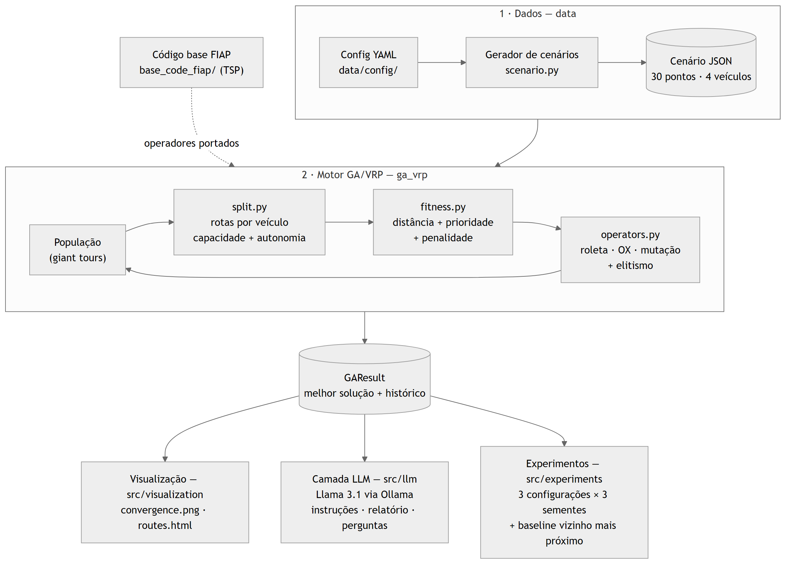
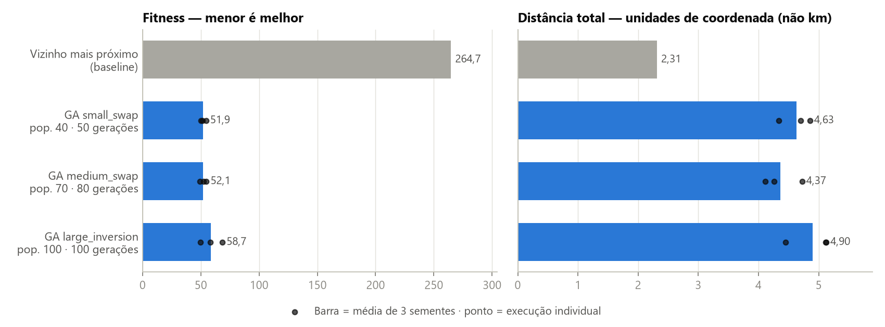
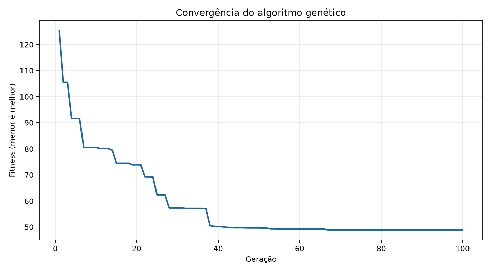
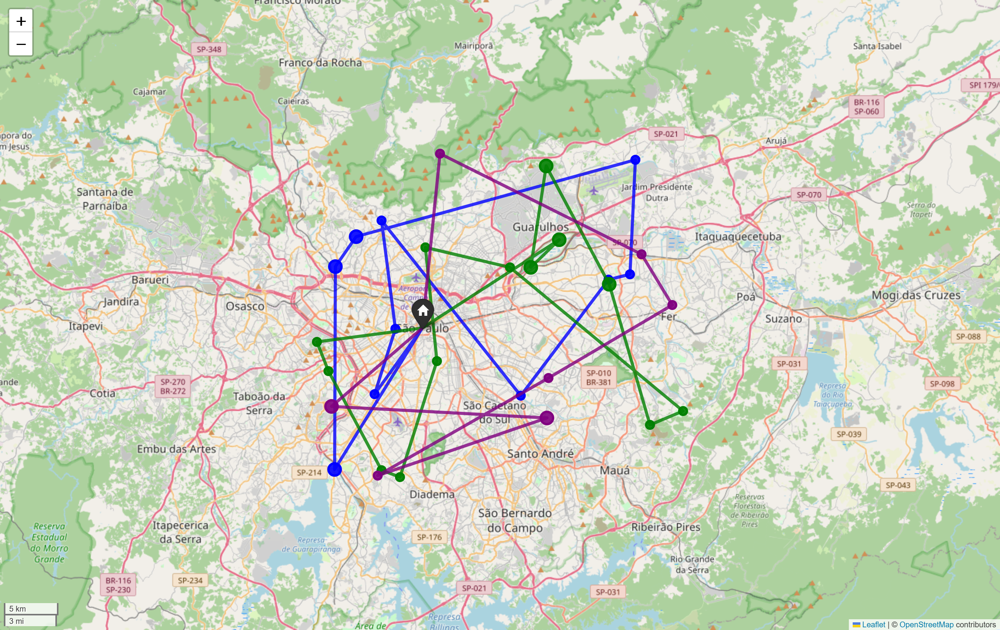
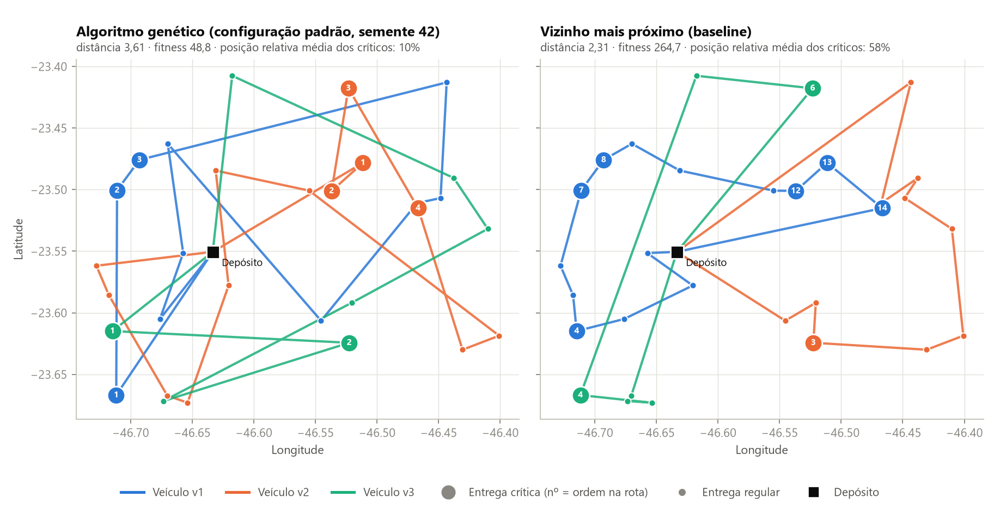

# Relatório Técnico — Otimização de Rotas Médicas

### Algoritmo Genético para VRP com restrições + LLM · Tech Challenge Fase 2, Projeto 2 · Pós-Tech FIAP

| Aluno | RM |
|---|---|
| Anderson Alves de Oliveira Mares | RM376889 |
| Caio Leandro de Santana | RM377048 |
| Gabrielle Miguel Feitosa | RM376095 |
| Duarte Deivide | RM376838 |

**Repositório Git:** <https://github.com/caiolsantana/techChallenge2>

**Vídeo de demonstração:** <https://vimeo.com/1241054183>

---

## Resumo

Transformamos o algoritmo genético (GA) para o Problema do Caixeiro Viajante (TSP) fornecido pela
FIAP em um sistema de roteamento de veículos (VRP) para distribuir medicamentos e insumos
hospitalares, com **prioridade de entregas, capacidade de carga, autonomia e múltiplos veículos**.
Uma LLM transforma a solução em instruções para motoristas, relatórios e respostas a perguntas.
Cenário de teste: 30 pontos de entrega em São Paulo (9 críticos) e 4 veículos com capacidades e
autonomias diferentes.

- **GA:** atende os 30 pontos com 3 veículos, sem violar capacidade ou autonomia, e coloca as 9
  entregas críticas nas primeiras posições das rotas; o fitness cai de 125,43 para 48,83 (−61%).
- **Comparativo:** fitness médio 78% a 80% menor que o da heurística do vizinho mais próximo, com
  distância maior — troca intencional para atender primeiro as entregas críticas.
- **LLM:** a revisão dos prompts elevou a nota das respostas de 9/18 para 18/18 na rubrica de avaliação.
- **Qualidade:** 16 testes automatizados; cenário versionado e sementes fixas tornam reproduzíveis
  as rotas, o fitness e as distâncias (instruções de execução no README do repositório).

## Visão geral da solução

A solução é um pipeline modular em Python (Figura 1). Um gerador cria o cenário sintético (depósito
na Praça da Sé, pontos com prioridade e demanda, frota dimensionada com folga); o motor GA/VRP
evolui as rotas; a melhor solução alimenta a visualização, a camada LLM e os experimentos.

| Módulo | Responsabilidade |
|---|---|
| `src/data/` | Gerador de cenários parametrizável (YAML) |
| `src/ga_vrp/` | Modelo de domínio, operadores, decodificação em rotas, fitness, validadores e loop do GA |
| `src/visualization/` | Gráfico de convergência (Matplotlib) e mapa interativo (Folium) |
| `src/llm/` | Prompts, integração com o Llama 3.1 via Ollama, coleta da avaliação e interface de linha de comando |
| `src/experiments/` | Configurações do GA e baseline do vizinho mais próximo |
| `tests/` | 16 testes automatizados (pytest), com LLM simulada |



*Figura 1 — Arquitetura: dados sintéticos → motor GA/VRP → visualização, LLM e experimentos.*

## 1. Implementação do algoritmo genético para roteamento a partir do código base fornecido

### 1.1 Código base e o que mudou

O código base (`FIAP/genetic_algorithm_tsp`, mantido sem alterações em `base_code_fiap/`) resolve um TSP:
cada indivíduo é uma permutação de cidades, o fitness é a distância do ciclo, há seleção por roleta,
Order Crossover (OX), mutação por troca e elitismo, com visualização em Pygame. Não trata múltiplos
veículos nem restrições.

### 1.2 Representação: "giant tour" + decodificação

O cromossomo continua sendo **uma permutação de todos os pontos de entrega**, sem marcadores de
veículo (*giant tour*). O módulo `split.py` decodifica essa permutação em rotas: percorre os pontos
em ordem e os adiciona ao veículo atual enquanto a carga e a distância da rota, contando a volta ao
depósito, couberem nos limites do veículo; quando não cabem, passa ao próximo veículo. Assim, toda
permutação vira uma solução que respeita capacidade e autonomia (pontos que não couberem na frota
ficam sem rota e são penalizados no fitness), os operadores do TSP são reaproveitados com a mesma
lógica e as restrições ficam concentradas em um único módulo.

### 1.3 Operadores genéticos

| Componente | Código base (TSP) | Implementação VRP (`src/ga_vrp/`) |
|---|---|---|
| População inicial | Permutações aleatórias de cidades | Permutações aleatórias dos pontos de entrega |
| Seleção | Roleta com peso `1/fitness` | Mesma roleta, protegida contra divisão por zero |
| Crossover | Order Crossover (OX) | Mesmo OX, aplicado com probabilidade configurável |
| Mutação | Troca de duas cidades vizinhas | Troca (padrão) ou inversão de trecho — esta implementa o TODO do código base |
| Elitismo | Melhor indivíduo preservado | Igual |
| Parada | Execução contínua (Pygame) | Número fixo de gerações |

### 1.4 Função fitness (a minimizar)

```
fitness = distância_total
        + 50     × Σ (posição do ponto crítico na rota ÷ nº de paradas da rota)
        + 10 000 × nº de pontos sem rota
```

Um ponto crítico na primeira parada não é penalizado; na última, custa perto de 50 (45 em uma rota
de 10 paradas). A penalidade de
10 000 faz qualquer solução incompleta perder para uma que atende todos, sem descartar o indivíduo.

### 1.5 Loop evolutivo, parâmetros e testes

A cada geração, o GA decodifica e avalia a população, preserva o melhor indivíduo e gera os filhos
por roleta, crossover e mutação — mesmo esqueleto do `tsp.py`. Parâmetros padrão: população 100,
100 gerações, crossover 1,0 e mutação 0,3 (troca). Semente fixa (42) e cenário versionado em JSON
garantem reprodutibilidade. Os 16 testes cobrem operadores, decodificação, validadores, penalidades,
baseline, visualizações, prompts, a conversão para quilômetros e a coleta das respostas da LLM para
avaliação.

## 2. Estratégias para lidar com restrições adicionais

**Capacidade e autonomia** são obrigatórias e garantidas na construção das rotas: o decodificador
nunca gera uma rota que as viole. **Prioridade e cobertura** são penalidades no fitness, o que
permite ao GA comparar soluções em vez de descartá-las.

| Restrição | Estratégia | Verificação |
|---|---|---|
| Capacidade de carga | `split.py` fecha a rota antes de exceder a capacidade do veículo | `is_capacity_respected` |
| Autonomia | `split.py` só aceita um ponto se a rota, com retorno ao depósito, couber na autonomia | `is_autonomy_respected` |
| Múltiplos veículos | Frota heterogênea; o split preenche os veículos em ordem e a ordem do cromossomo define quantos são usados | Uma rota por veículo usado |
| Prioridade | Penalidade proporcional à posição relativa de cada entrega crítica (peso 50) | Posição dos críticos por rota |
| Cobertura | Penalidade de 10 000 por ponto sem rota; o programa não trava por falta de frota | `all_points_visited_once` |

O gerador de cenários dimensiona a capacidade a partir da demanda média e do número de pontos por
veículo, e a autonomia a partir do tamanho da área e do número de pontos por veículo, sempre com
margem de folga para reduzir o risco de cenários inviáveis.

*Tabela 1 — Rotas da solução padrão do GA (semente 42). Distâncias em unidades de coordenada; a
coluna "km" é o equivalente aproximado em linha reta (Haversine), não o percurso pelas ruas.*

| Veículo | Paradas | Carga / capacidade | Distância / autonomia | km | Entregas críticas |
|---|---:|---:|---:|---:|---|
| v1 | 10 | 30,53 / 33,33 (92%) | 1,237 / 3,196 (39%) | 133,2 | 1ª, 2ª e 3ª paradas |
| v2 | 13 | 31,92 / 33,51 (95%) | 1,224 / 3,184 (38%) | 131,2 | 1ª a 4ª paradas |
| v3 | 7 | 19,89 / 24,76 (80%) | 1,144 / 2,909 (39%) | 119,7 | 1ª e 2ª paradas |
| v4 | não utilizado | — / 24,97 | — / 3,715 | — | — |
| **Total** | **30** | **82,34** (toda a demanda) | **3,605** | **384,1** | **9 de 9 no início** |

A carga é a restrição que limita as rotas neste cenário; a autonomia tem folga de cerca de 60%. Em
todas as execuções do GA e no baseline, não houve violações e os 30 pontos foram atendidos.

## 3. Integração com LLMs para geração de instruções e relatórios

### 3.1 Arquitetura e casos de uso

- **Modelo:** Llama 3.1 8B (`llama3.1`) rodando localmente pelo Ollama, sem custo de API e sem
  depender de internet depois que o modelo é baixado.
- **Contexto:** o prompt recebe um JSON gerado diretamente da melhor solução do GA (rotas, ordem,
  prioridades, cargas e totais), nunca dados digitados à mão.
- **Segurança:** como o modelo roda na própria máquina, nenhum dado da solução sai dela.

| Caso de uso | Comando | Resultado |
|---|---|---|
| Instruções de entrega | `python -m src.llm instructions --provider ollama` | Roteiro por motorista, com a prioridade de cada entrega indicada |
| Relatório operacional | `python -m src.llm report --provider ollama` | Rotas, paradas, carga, distância e pontos sem rota |
| Perguntas livres | `python -m src.llm ask --question "..." --provider ollama` | Resposta com base nos dados da solução enviados no prompt |

### 3.2 Engenharia de prompt

O prompt de sistema instrui o modelo a responder em português, a não inventar endereços, horários
ou economia e a não omitir pontos sem rota. A principal lição veio da avaliação: o modelo errava contagens
quando precisava derivá-las do JSON. Passamos a **enviar os totais já calculados** e, em perguntas
sobre entregas críticas, apenas a lista desses pontos. Pelo mesmo motivo, os **quilômetros** também
chegam prontos: para cada rota, o JSON traz a distância em unidades de coordenada (`distance`) e o
equivalente aproximado em km em linha reta (`distance_km`), calculado pela fórmula de Haversine
trecho a trecho, do depósito ao depósito. O prompt pede que a resposta informe as duas unidades,
deixe claro que os km não são o percurso pelas ruas e nunca converta valores por conta própria.
Converter com um fator fixo (1° ≈ 111 km) superestimaria as rotas da solução padrão em 3% a 6%,
porque em São Paulo 1° de longitude vale cerca de 102 km.

### 3.3 Avaliação de qualidade

Rubrica de 0 a 2 pontos em três dimensões: **correção factual** (comparada à solução do GA),
**clareza** e **utilidade**. Modelo: Llama 3.1 8B local (Ollama), cenário padrão, semente 42.

*Tabela 2 — Notas antes e depois da revisão dos prompts (máximo 6 por caso).*

| Caso | 1ª rodada | Após revisão | Evidência |
|---|---:|---:|---|
| Instruções | 5/6 | 6/6 | Nas duas rodadas, 30 pontos na ordem correta; na 1ª, anunciou destaque dos críticos sem aplicá-lo |
| Relatório | 3/6 | 6/6 | 1ª rodada: "10 paradas por veículo" (real: 10, 13 e 7); depois, todos os totais corretos |
| Perguntas | 1/6 | 6/6 | 1ª rodada omitiu 2 críticos e incluiu 4 regulares; depois, os 9 com veículo e ordem |
| **Total** | **9/18** | **18/18** | |

A avaliação cobre um cenário e um modelo. As notas foram atribuídas antes da inclusão dos
quilômetros no prompt (seção 3.2); o cálculo dos km é coberto pelos testes automatizados.

## 4. Comparativo de desempenho com outras abordagens de roteamento

### 4.1 Metodologia

Mesmo cenário e mesma frota para todas as abordagens. O **baseline** é a heurística gulosa do
**vizinho mais próximo**: cada veículo vai sempre ao ponto viável mais próximo, respeitando
capacidade e autonomia. O GA rodou em três configurações, cada uma com as sementes 42, 73 e 101.

| Configuração | População | Gerações | Crossover | Mutação | Operador |
|---|---:|---:|---:|---:|---|
| `small_swap` | 40 | 50 | 0,6 | 0,1 | Troca |
| `medium_swap` | 70 | 80 | 0,8 | 0,3 | Troca |
| `large_inversion` | 100 | 100 | 1,0 | 0,5 | Inversão |

### 4.2 Resultados

*Tabela 3 — Médias de três sementes. Nenhum método teve violações ou pontos sem rota. Os tempos
variam conforme a máquina.*

| Método | Fitness | Distância | Tempo (s) | Geração do melhor resultado |
|---|---:|---:|---:|---|
| Vizinho mais próximo | 264,69 | 2,31 | 0,002 | — |
| GA `small_swap` | 51,92 | 4,63 | 1,17 | 48 a 50 (de 50) |
| GA `medium_swap` | 52,09 | 4,37 | 2,32 | 74 a 77 (de 80) |
| GA `large_inversion` | 58,72 | 4,90 | 4,70 | 94 a 99 (de 100) |
| GA padrão (1 execução) | 48,83 | 3,61 | — | 90 (de 100) |



*Figura 2 — Barra = média de três sementes; pontos = execuções individuais.*

### 4.3 Análise

- **O GA vence no objetivo definido:** fitness médio 78% a 80% menor, porque atende cedo as
  entregas críticas (posição relativa média dos críticos de 10% na solução padrão do GA, contra 58%
  no baseline).
- **O baseline vence em distância pura** (2,31 contra 3,61 a 4,90). O ganho do GA não deve ser lido
  como economia de quilômetros: é uma troca intencional, e o peso de prioridade (50) é ajustável —
  na solução padrão, ele responde por 45,2 dos 48,8 pontos de fitness.
- **Configurações:** médias próximas; três sementes não bastam para eleger a melhor.
- **Convergência:** o melhor resultado surgiu nas últimas gerações, então mais gerações ainda podem
  melhorar. O tempo acompanha o tamanho da execução (população × gerações), de 1,17 s a 4,70 s em
  média, viável nesta escala.

## 5. Visualizações e análises das rotas otimizadas



*Figura 3 — Melhor fitness por geração (configuração padrão, semente 42).*

**Convergência:** o fitness cai de 125,43 para cerca de 50 até a geração 38 e depois tem só ajustes
finos até 48,83 (geração 90). Com elitismo, a curva nunca sobe.



*Figura 4 — Mapa interativo (`results/figures/routes.html`): v1 azul, v2 verde, v3 roxo; círculos maiores são entregas críticas.*

**Mapa interativo (Folium):** uma cor por veículo; ao passar o mouse, aparecem veículo, ordem da
parada, ID e prioridade. Pontos sem rota apareceriam em vermelho (não há nenhum). As linhas são
retas entre coordenadas, não o traçado das ruas.



*Figura 5 — Mesmos pontos e frota; o número em cada círculo é a ordem da entrega crítica na rota.*

**GA × baseline:** o vizinho mais próximo forma rotas compactas, mas deixa críticos para o meio e o
fim (o veículo v1 só os atende entre a 4ª e a 14ª paradas). O GA cruza mais as rotas, porém atende
todos os críticos entre a 1ª e a 4ª parada — exatamente o que a função objetivo pede.

## 6. Arquitetura da solução em nuvem

A implementação em nuvem ficou fora do escopo por decisão do grupo, que priorizou o núcleo
obrigatório (GA com restrições, LLM, experimentos e testes). A solução roda inteiramente local,
com o Llama 3.1 no Ollama. Para publicá-la, um caminho seria empacotar o pipeline em um contêiner,
expor endpoints de otimização e relatório e servir o Llama 3.1 em uma máquina com GPU, sem alterar
o motor do GA.

## 7. Limitações e próximos passos

- **Distâncias** euclidianas sobre latitude/longitude no GA; os km informados pela LLM são aproximações em linha reta (Haversine). Próximo passo: otimizar direto em km e usar rotas por ruas (OSRM).
- **Decodificação** gulosa: um split ótimo pode encontrar cortes melhores sem mudar o restante do pipeline.
- **Prioridade** medida pela posição na rota: penalizar a distância até cada entrega crítica, ou usar janelas de tempo.
- **Experimentos e LLM** avaliados em um cenário: ampliar cenários, sementes e modelos, e testar a sensibilidade do peso de prioridade.
